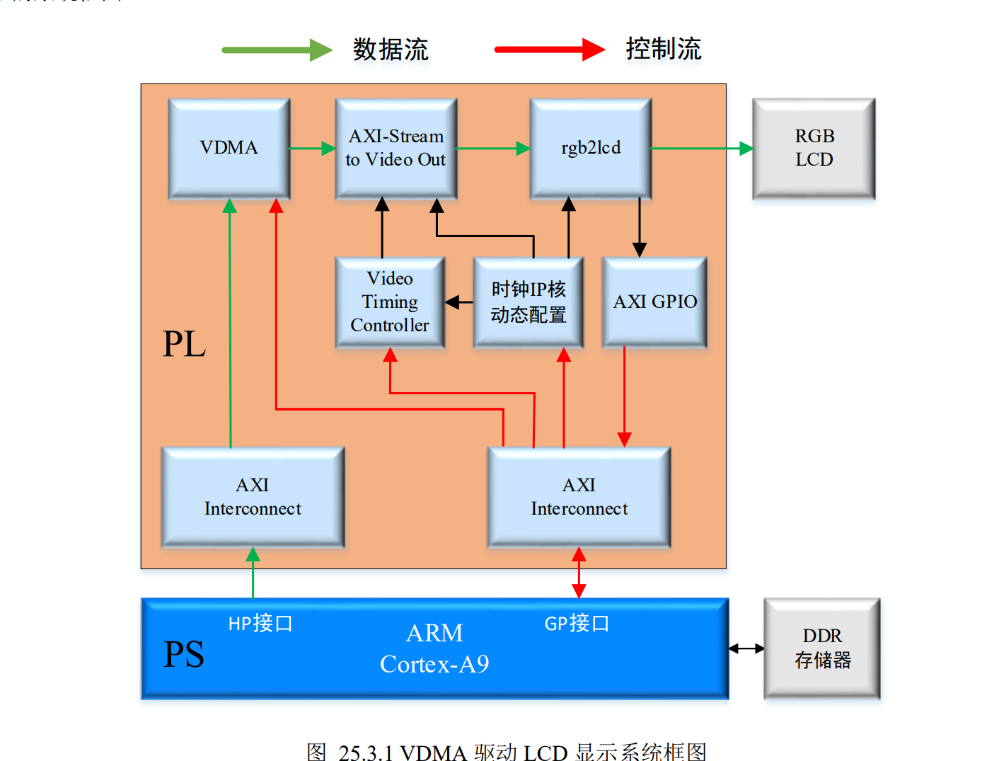

# AXI VDMA 四种 Genlock 模式说明

## 1. Genlock 要解决什么问题

AXI VDMA 的 S2MM 通道通常负责把 AXI4-Stream 视频写入 DDR，MM2S 通道则从 DDR 读出视频流。输入和输出速率不一致时，若两边同时访问同一个帧缓存，就可能读到正在写入的画面，或覆盖尚未读完的画面。

Genlock（同步锁相）让读写通道围绕帧缓存编号（frame pointer）协调工作，避免两通道同时访问同一帧。它解决的是帧缓存的访问协调问题；帧缓存数量、帧同步源、通道启动和缓存地址仍需在设计中正确配置。

以下“主/从”表示帧编号参考关系，不等同于 AXI4-Stream 的 master/slave 接口方向。VDMA 的 S2MM 是视频写入 DDR 的通道，MM2S 是从 DDR 读出视频的通道；主模式和从模式都可配置在任一通道上。

## 2. 四种模式一览

| 模式 | 帧编号行为 | 从属/参考关系 | 典型用途 |
|---|---|---|---|
| Genlock Master（主） | 按自身帧缓存循环工作，输出当前帧编号；不根据输入的帧编号跳帧或重帧 | 提供帧编号参考 | 需要固定帧延迟的同步关系 |
| Genlock Slave（从） | 依据主模式的帧编号及配置的帧延迟，跟随主通道；速率不匹配时可跳过或重复帧 | 跟随一个 Genlock Master | 主从之间有确定的帧延迟要求 |
| Dynamic Genlock Master（动态主） | 观察动态从通道正在使用的帧缓存，避开该帧；必要时跳帧或重复帧 | 主动避开 Dynamic Genlock Slave 当前使用的帧 | 读写速率会变化，需要动态避免读写冲突 |
| Dynamic Genlock Slave（动态从） | 跟随动态主通道，使用其先前操作过的帧缓存；必要时跳帧或重复帧 | 跟随一个 Dynamic Genlock Master | 由动态主通道提供帧编号参考 |

## 3. 各模式的具体作用

### 3.1 Genlock Master（同步锁相主模式）

主通道按自身配置的帧缓存顺序运行，并输出当前帧编号供从通道参考。它不监视输入到自身的 frame pointer，也不会因为从通道正在使用某个帧缓存而自动避开该帧。

因此它提供的是稳定的帧编号基准。配对的 Genlock Slave 按配置的帧延迟跟随主通道。该模式适合帧延迟已知、缓存访问关系可预先安排的场景；不能把“Master”理解为自动检查并保证永远不发生读写冲突。

### 3.2 Genlock Slave（同步锁相从模式）

从通道读取主通道提供的帧编号，并按照帧延迟设置跟随主通道。主从帧速率不一致时，从通道可跳过或重复帧，以保持相对帧位置。

此模式适用于需要主从保持指定帧延迟的场景。配置时要正确设置帧延迟，并选择要跟随的 Genlock Master；仅把通道设为 Slave 并不会自动选出正确的参考通道。

### 3.3 Dynamic Genlock Master（动态同步锁相主模式）

动态主通道监视动态从通道当前使用的帧编号，避免访问从通道正在使用的帧缓存。为避免两边速率差异造成追赶或等待，它可通过跳过帧或重复帧来调整访问位置。

与普通 Master 的关键差异是：动态主会参考从通道的实时帧编号并主动避让；普通 Master 只输出自己的帧编号，不根据从通道状态避让。动态主/从配对时，应启用 Genlock，并正确建立内部或外部 frame pointer 连接。

### 3.4 Dynamic Genlock Slave（动态同步锁相从模式）

动态从通道采样动态主通道的帧编号，并跟随主通道。它访问动态主先前操作过的帧缓存；若两通道速率不匹配，可跳过或重复帧来维持跟随关系。

该模式与普通 Slave 的关键差异是：动态模式按动态主通道的帧缓存进度跟随，不依赖固定帧延迟来定义相对位置。适用于读写速率存在变化、需要动态协调帧缓存访问的场景。

## 4. Master/Slave 与 Dynamic 的核心区别

- **普通 Master/Slave：**以主通道帧编号和预设帧延迟建立关系。主通道本身不会因从通道的实时占用而避开帧缓存。
- **Dynamic Master/Slave：**双方利用对方的帧编号状态动态协调，主通道会避开动态从通道当前使用的缓存；在速率不匹配时通过跳帧或重复帧维持可用的读写关系。
- **跳帧/重复帧是速率协调手段：**画面可能丢失某些输入帧，或在一段时间内重复显示某帧。这不同于图像撕裂；Genlock 的目标是避免读写同时命中同一帧缓存。

## 5. 选择建议

- **彩条或静态图，只写一次、持续读取：**通常不需要多帧写读协调；单帧缓存就能完成基本显示。
- **固定帧延迟的生产者/消费者关系：**考虑普通 Master/Slave，并核对帧延迟、帧缓存数量和帧同步配置。
- **摄像头持续写入、显示端持续读取，且两端速率可能不同：**通常考虑 Dynamic Genlock Master/Slave 配合多帧缓存，让读写通道动态避开对方正在访问的帧。
- **只有单帧缓存：**Genlock 无法凭空创造额外缓存空间，也不能消除所有覆盖/撕裂风险。需要根据吞吐量与时序设计足够的帧缓存。

## 6. 配置时需要核对

1. 确认 S2MM（写）与 MM2S（读）分别配置了正确的 Genlock 模式，并明确哪一侧是参考主通道。
2. 确认 frame pointer 信号的连接方式。若使用 VDMA 内部 Genlock 路径，通常由 IP 内部连接；若使用外部连接，需正确连接对应的 `*_frame_ptr_out` 与 `*_frame_ptr_in`。
3. 按所选模式使能 Genlock。动态主/从配对还需确认 Genlock 源配置正确。
4. 配置足够数量的帧缓存及有效地址，并确保写、读通道的帧同步和循环设置符合应用需求。
5. 留意 AXI VDMA 产品指南对具体 IP 版本、帧延迟、帧缓存数量和内部/外部 Genlock 连接的限制；不要仅凭模式名称推断整套系统已同步。

## 7. 一句话记忆

- **普通主：**给出自己的帧编号。
- **普通从：**按主帧编号和固定帧延迟跟随。
- **动态主：**观察动态从在用的帧，主动避开。
- **动态从：**跟随动态主的帧进度。

## 参考资料

- AMD/Xilinx《AXI Video Direct Memory Access LogiCORE IP Product Guide (PG020)》：[Genlock Synchronization](https://docs.amd.com/r/en-US/pg020_axi_vdma/Genlock-Synchronization)、[GenLock Mode](https://docs.amd.com/r/en-US/pg020_axi_vdma/GenLock-Mode)、[Genlock Master](https://docs.amd.com/r/en-US/pg020_axi_vdma/Genlock-Master)、[Dynamic Genlock Master](https://docs.amd.com/r/en-US/pg020_axi_vdma/Dynamic-Genlock-Master)、[Dynamic Genlock Slave](https://docs.amd.com/r/en-US/pg020_axi_vdma/Dynamic-Genlock-Slave)。
